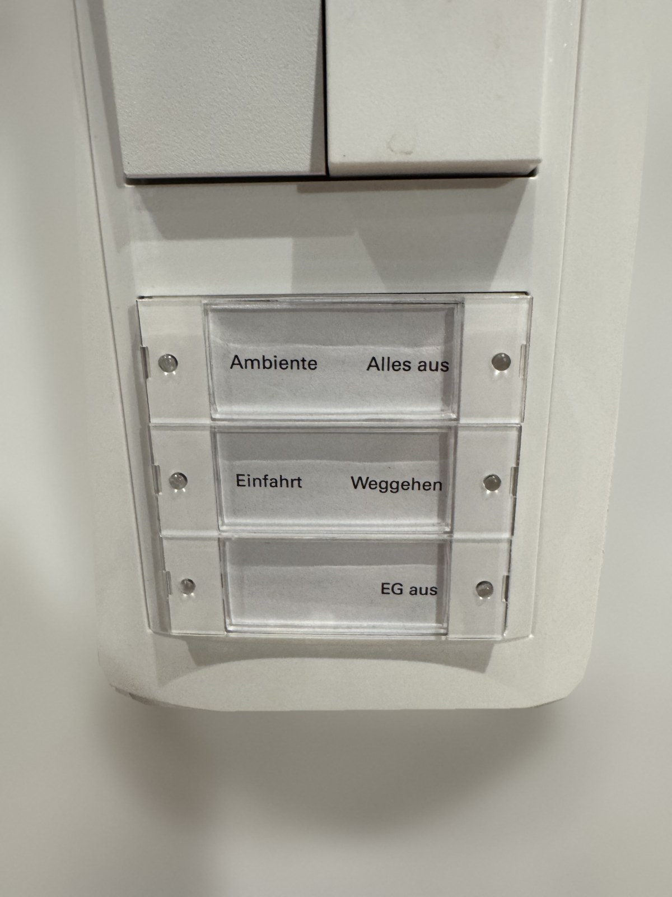
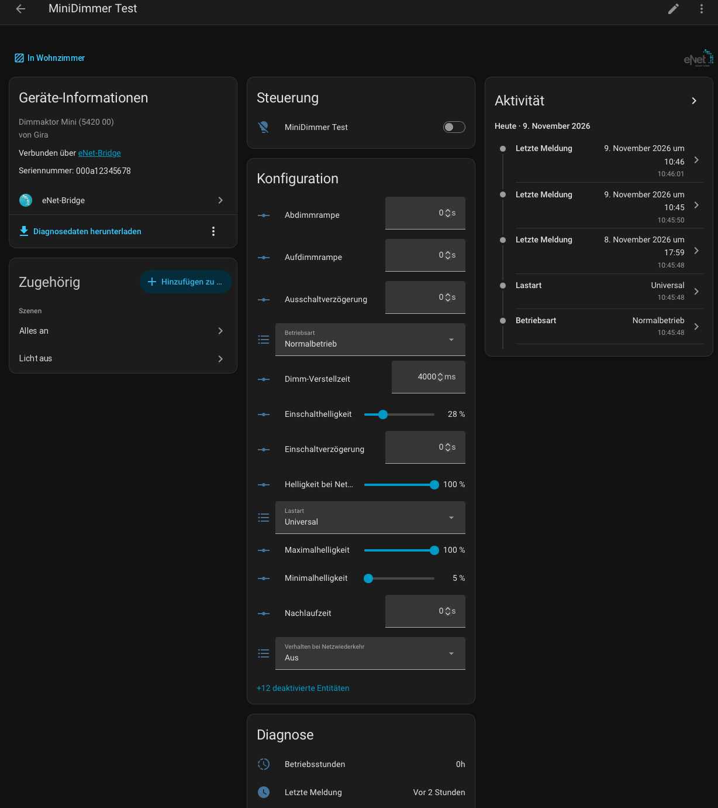
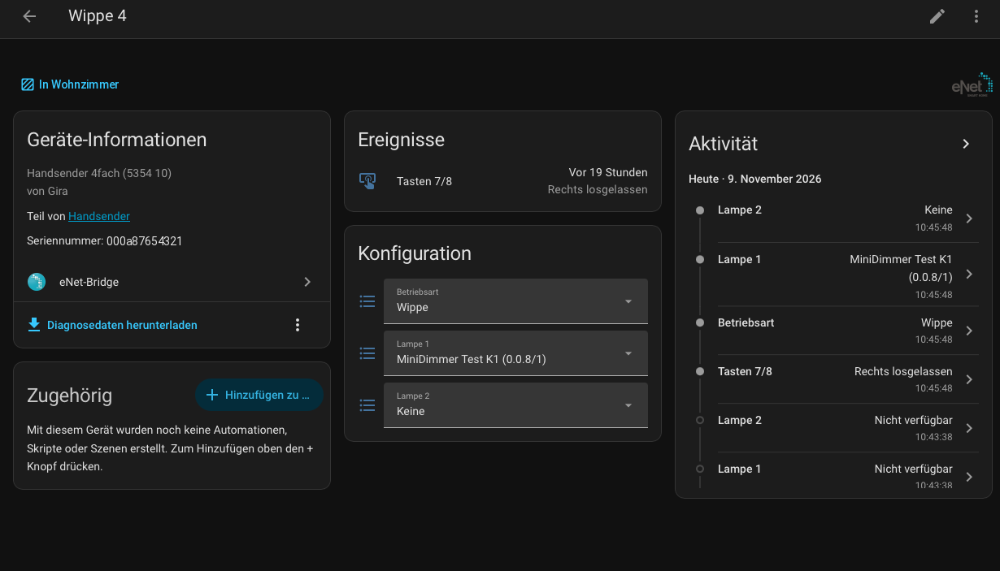

# eNet-Bridge für Home Assistant

**Gira/Jung-eNet**-Funkgeräte direkt in Home Assistant nutzen – **ohne eNet Server**.

Ein kleines USB-Funkmodem (ESP32-C6 + CC1101, Teile für etwa 20–30 €) übernimmt die Aufgaben des eNet Servers: Es
spricht das eNet-Funkprotokoll (KNX RF 1.1, 868 MHz), beantwortet die Server-Tasten der Sender, führt Szenen aus
und meldet jeden Tastendruck und jede Zustandsänderung an Home Assistant. Die Integration übernimmt die bestehende
Anlage aus dem Export des eNet Servers – **kein Gerät muss neu eingelernt werden**.

**Nie einen eNet Server gehabt?** Du kannst auch bei null anfangen: neue Anlage einrichten, eNet-Aktoren sowie
Wand- und Handsender mit „+“ in Home Assistant einlernen und alles dort einstellen – ein eNet Server wird zu keiner
Zeit gebraucht.

*English: [README.md](README.md)*

> **In Arbeit – erste öffentliche Version.** Die Integration läuft täglich in zwei echten Anlagen, die
> Dokumentation wird aber noch ergänzt, und getestet sind nur die unten genannten Gerätetypen. Rückmeldungen und
> Issues sind willkommen.

> **Unabhängiges Projekt.** Nicht verbunden mit Insta, Gira oder Jung, von ihnen weder unterstützt noch geprüft.
> Nutzung auf eigene Verantwortung. Siehe [Marken und Herkunft](#marken-und-herkunft).

## Warum den eNet Server ersetzen?



Ich habe selbst einen eNet Server. Er funktioniert sehr gut und ist mit der
[eNet-Integration von mnordseth](https://github.com/mnordseth/enet-homeassistant) gut in Home Assistant
eingebunden. Trotzdem hatte ich drei Hauptgründe:

1. **Der eNet Server ist abgekündigt.** Was passiert, wenn meiner kaputtgeht? Einen Ersatz-Server auf Lager zu
   legen, war mir zu teuer.
2. **Die Tastsensoren.** Ich finde die Gira-System-55-Taster sehr schön, wir haben sie überall verbaut. Um
   Szenen oder spezielle Funktionen aufzurufen, ist der eNet-Tastsensor ideal. Die Anbindung an Home Assistant
   ist aber unvollständig: Über den Server geht es, doch der Sensor bekommt keine Rückmeldung.
3. **Zwei parallele Systeme.** Mit eNet und Home Assistant pflegt man beides: Szenen müssen in eNet geändert
   werden, sobald sie eNet-Komponenten betreffen, und Home-Assistant-Geräte müssen per Automation dazugehängt
   werden. Ich wollte alle Geräte über Home Assistant konfigurieren und programmieren können.

<br clear="right">

## Was die Bridge kann

- **Bestehende Anlage übernehmen** aus dem Export des eNet Servers (`.iex`): Geräte, Räume, Szenen,
  Tastenbelegung. Die Bridge verwendet Domäne und Kennung des Servers, Aktoren und Sender arbeiten weiter wie
  bisher.
- **„Nur mithören“**, um die Bridge zuerst neben dem echten eNet Server zu betreiben – sie empfängt alles und
  sendet nichts. Umgestellt wird, wenn du so weit bist.
- **Neue Anlage ohne eNet Server**: bei null anfangen und eNet-Aktoren und -Sender direkt aus Home Assistant
  einlernen – z. B. um Gira/Jung-eNet-Wand- und Handsender als batteriebetriebene Funktaster in Home Assistant zu
  nutzen, ohne je einen eNet Server zu kaufen.
- **Lampen**: Schalt- und Dimmaktoren als `light`-Entitäten mit echter Rückmeldung (Statusmeldungen der Aktoren,
  Statusabfrage nach Befehlen).
- **Sender** (Hand- und Wandsender): jede Taste als Ereignis-Entität – gedrückt/losgelassen mit Haltedauer, damit
  Automationen kurz, lang und Doppelklick unterscheiden können. Batteriezustand je Sender.
- **Sender aus Home Assistant belegen**: je Wippe „Wippe“ (schaltet/dimmt Lampen direkt) oder „zwei
  Einzeltasten“ (Server-Tasten mit grüner Quittungs-LED); Lampen je Wippe – eNet-Aktoren oder Lampen/Schalter
  jeder anderen Home-Assistant-Integration (Hue, Zigbee, Matter …), die Home Assistant schaltet und dimmt, mit
  grüner Quittung durch die Bridge; Aktion je Taste (nur melden, Szene aufrufen); „Sender programmieren“
  schreibt es ins Gerät.
- **Szenen**: Die Home-Assistant-Szene ist das Original. eNet-Lampen bekommen die Szene zusätzlich im Aktor
  gespeichert, dadurch schaltet eine Szene sie alle gleichzeitig mit einem einzigen Funktelegramm. Szenen auf
  Sender-Tasten führt die Bridge selbst aus – auch wenn Home Assistant gerade beschäftigt ist.
- **Geräte einlernen und entfernen** ohne eNet Server („+“ an der Integration, Löschen am Gerät).
- **Geräte-Einstellungen** (Einschalthelligkeit, Rampen, Verzögerungen, Lastart, …) als Entitäten, aus den
  Aktoren gelesen und in sie geschrieben.
- **Sonnensensor** (Jung FM FS 1 S / Gira 5461 02): Helligkeit, Sonnenschutz und Dämmerung, Szenen-Ereignisse,
  Einstellungen; je Kanal und Richtung (ein/aus) eine frei wählbare Szene.
- **Reparaturen**: Geräte, die nicht antworten, fehlende Szenen-Verknüpfungen, unbekannte Sender und unerwartete
  Verknüpfungen in den Aktoren (Überbleibsel früherer Belegungen, Links fremder Geräte) erscheinen unter
  *Einstellungen → Reparaturen* – entfernt wird erst nach Bestätigung.
- Die Bridge-Firmware spielt die Integration selbst ein und aktualisiert sie; das Funkmodul wird automatisch
  kalibriert.
- Oberfläche auf Deutsch und Englisch.

## Bildschirmfotos

**Ein Dimmaktor** – Lampe, alle Geräteeinstellungen direkt aus dem Aktor gelesen, Diagnose:



**Eine Wippe eines Handsenders** – Betriebsart und Lampen in Home Assistant wählen, dann „Sender programmieren“:



## Unterstützte Geräte

Getestet in zwei Anlagen:

| Art | Geräte |
|---|---|
| Schaltaktoren | Mini 1fach (SA1M, SA1MP), Mini 2fach (SA2M), Zwischenstecker (SA1Z) |
| Dimmaktoren | Mini-Dimmer (DA1M), DALI Mini (SD1M) |
| Sender | Wandsender 3fach (WS3BG), Handsender 4fach (HS4) |
| Sensoren | Sonnen-/Dämmerungssensor (SF1S, Jung FM FS 1 S) |

**Aus dem Herstellerkatalog umgesetzt, am Gerät noch nicht getestet** – in Home Assistant mit „(ungetestet)“
im Modellnamen. Wer eines davon hat: Bitte melden, ob es funktioniert (am besten als Issue mit der Datei aus
„Diagnosedaten herunterladen“):

| Art | Geräte | In Home Assistant |
|---|---|---|
| Jalousieaktoren | Mini (5427 00), REG 1fach (5437 00) und 4fach (5435 00), System-2000-Aufsatz (5491) | Rollladen: Auf/Ab/Stopp, Position, Lamelle |
| Energiesensoren | Mini (5471 00), Zwischenstecker (5472 02), REG 4fach (5473 00) | Spannung, Strom, Wirk-/Blind-/Scheinleistung, Energie (Energie-Dashboard) |
| Bewegungsmelder | Jung FMDW360WW | Bewegung, Helligkeit |
| Repeater | Zwischenstecker (5321 02) | Signal, letzte Meldung |
| REG-Schalt-/Dimmmodule | 5430 00, 5431 00, 5433 00 | wie die Mini-Aktoren |

Gerätedefinitionen (Parameter) für alle 41 eNet-Gerätetypen des Katalogs sind enthalten. Verschlüsselte Anlagen
(eNet Server 2.0 mit AES) werden nicht unterstützt.

## Hardware

Zwei Wege, beide per USB am Home-Assistant-Rechner und mit derselben Firmware:

- **Selbst bauen:** Seeed **XIAO ESP32-C6** + CC1101-Modul für 868 MHz (7 Drähte) + 868-MHz-Antenne.
- **Fertig kaufen:** **busware CUL32** (ESP32-C6 + CC1101 mit Antennenbuchse, ohne Löten) – gleiche Pinbelegung,
  sollte laufen, am Gerät selbst aber noch nicht getestet.

Der ursprüngliche Aufbau mit **ESP32-DevKit** (klassischer ESP32) **läuft aus**: Vorhandene Bridges funktionieren
weiter und bekommen ihre Firmware weiterhin von der Integration, neue Funktionen entstehen aber nur noch für den
ESP32-C6, und in einer späteren Version endet die Unterstützung. Teileliste, Verdrahtung, Antenne und Messwerte:
**[docs/HARDWARE.md](docs/HARDWARE.md)** (Englisch).

## Installation

Voraussetzungen: Home Assistant **2026.10** oder neuer, ein freier USB-Anschluss am HA-Rechner.

**Mit HACS:** *HACS → ⋮ → Benutzerdefinierte Repositories*, `https://github.com/engiadina/enet-bridge` als Typ
*Integration* hinzufügen, dann **eNet Bridge** installieren und Home Assistant neu starten.

**Von Hand:** den Ordner `custom_components/enet_bridge` nach `/config/custom_components/` deines Home Assistant
kopieren und neu starten.

Danach: *Einstellungen → Geräte & Dienste → Integration hinzufügen → eNet-Bridge.*

## Einrichten

Die Einrichtung fragt, woher die Anlage kommt:

- **Aus einem Export des eNet Servers übernehmen (.iex)** – das Projekt in der Weboberfläche des eNet Servers
  exportieren und die Datei hochladen. Das Häkchen **„eNet Server ist ausgeschaltet“** weglassen, solange der
  Server noch läuft: Die Bridge startet dann mit **„Nur mithören“**.
- **Neue Anlage ohne eNet Server** – für Anlagen, die nie einen Server hatten, oder wenn er ohne Export
  ausgefallen ist. Domäne und Kennung werden erzeugt; jedes Gerät in den Lernmodus bringen und mit „+“ einlernen
  (immer nur ein Gerät gleichzeitig). Sender werden direkt nach dem Einlernen programmiert.
- **Bestehende Anlagendatei** (`anlage.json`, aus `tools/iex.py`).

Danach den seriellen Port der Bridge wählen. Hat die Platine noch keine Bridge-Firmware, über die Update-Entität
**„Bridge-Firmware“** installieren.

### Umstieg vom eNet Server

1. Vollständiges Home-Assistant-Backup anlegen.
2. Integration aus dem Export einrichten, Server läuft weiter → „Nur mithören“.
3. Ein paar Tage beobachten: Kommen alle Tastendrücke als Ereignisse an, folgen die Lampenzustände? (Im Mithören
   stehen Lampen, die noch nicht geschaltet wurden, auf „unbekannt“ – die Bridge fragt nicht ab.)
4. Automationen auf die neuen Tasten-Ereignisse vorbereiten, aber **ausgeschaltet** lassen – sonst lösen sie
   doppelt aus.
5. Alte Automationen aus, **eNet Server vom Strom**, dann an der Bridge **„Nur mithören“** ausschalten. Die
   Bridge fragt jetzt alle Aktoren ab, wandelt die eNet-Szenen in Home-Assistant-Szenen um (*Einstellungen →
   Automationen & Szenen → Szenen*) und beantwortet die Server-Tasten.
6. Die alte eNet-Integration (falls vorhanden) entfernen und auf Wunsch die neuen Lampen-Entitäten auf die alten
   Entitäts-IDs umbenennen, damit Dashboards und Automationen weiter passen.
7. Neue Automationen einschalten, jede Taste und jede Szene testen.

Bis Schritt 6 geht es jederzeit zurück: Server wieder einschalten, „Nur mithören“ an.

## Bedienung

**Tasten.** Eine Wippe, die Lampen direkt schaltet, meldet `links_gedrueckt` / `links_losgelassen` /
`rechts_gedrueckt` / `rechts_losgelassen`, eine Einzeltaste `gedrueckt` / `losgelassen`. Das Loslassen trägt
`hold_ms`, z. B. für einen langen Druck:

```yaml
triggers:
  - trigger: state
    entity_id: event.flur_wippe_1_taste_2
    not_from: [unavailable, unknown]
conditions:
  - condition: template
    value_template: >-
      {{ trigger.to_state.attributes.event_type == 'losgelassen'
         and trigger.to_state.attributes.hold_ms | int(0) >= 1000 }}
```

Grün quittiert wird nur, wenn der Sender eine Antwort erwartet: bei Einzeltasten (die Bridge antwortet) und bei
Wippen mit Lampen (der Aktor antwortet). Eine Wippe ohne Lampen sendet ihren Wert, ohne zu fragen – keine LED.
Für reine HA-Tasten mit LED die Wippe auf **zwei Einzeltasten** mit Aktion **„Nur melden“** stellen und
**„Sender programmieren“** drücken (danach eine Taste am Sender drücken, um ihn zu wecken). Die Integration legt
dafür den Blueprint **„eNet Bridge – transmitter single keys“** (kurz/lang je Taste) unter
`blueprints/automation/enet_bridge/` an.

**Wippe mit Home-Assistant-Lampen.** Eine Wippe kann auch Lampen anderer Integrationen schalten und dimmen: auf der
Geräteseite des Senders als „Lampe 1/2“ wählen (oder unter *Konfigurieren → Sender belegen*). Linke Taste = ein /
heller, rechte = aus / dunkler; halten dimmt. Kommt die erste HA-Lampe dazu oder fällt die letzte weg, wird der
Sender programmiert; welche HA-Lampen es sind, gilt sofort. Die Bridge quittiert die Wippe (grüne LED) nur, solange
kein eNet Server läuft; Home Assistant schaltet die Lampen in jedem Fall.

**Szenen.** Ganz normal als Home-Assistant-Szenen anlegen und bearbeiten. eNet-Lampen einer Szene bekommen die
Werte in den Aktoren gespeichert (die Aktoren starten dabei kurz neu – die Lampen flackern einmal). Einer
Einzeltaste weist man eine Szene über ihre Aktions-Auswahl zu.

**Einlernen.** „+“ an der Integration → *Gerät hinzufügen* → Gerät in den Lernmodus versetzen (Mini-Aktoren:
Taste am Gerät 4 s drücken). **Entfernen:** Gerät in Home Assistant löschen; es wird auf Werkszustand
zurückgesetzt.

**Dienste:** `enet_bridge.geraet_einlernen`, `geraet_entfernen`, `sender_programmieren`, `verknuepfungen_lesen` (Link-Tabellen der Aktoren lesen und bewerten), `szene_anlegen` /
`szene_loeschen` (eNet-Szenen), `release` / `reconnect` (seriellen Port freigeben / neu öffnen).

## Fehlersuche

- **„Funkmodul“ aus:** Verdrahtung oder 3,3-V-Versorgung des CC1101.
- **Ein Gerät meldet sich nie / „antwortet nicht“ unter Reparaturen:** Sensor „Signal“ des Geräts ansehen; unter
  ≈ −90 dBm Bridge oder Antenne umstellen, Antennenanschluss prüfen
  ([HARDWARE.md](docs/HARDWARE.md#antenna-connection)).
- **„Echter eNet Server aktiv“:** Die Bridge hört den originalen Server – beide beantworten die Server-Tasten.
  Server ausschalten.
- **Tasten lösen nach dem Umstieg doppelt aus:** alte und neue Automationen sind beide an.
- **Eine Lampe reagiert auf Tasten, die sie nicht betreffen** (z. B. dimmt beim Loslassen): für sie
  `enet_bridge.verknuepfungen_lesen` aufrufen und unter Reparaturen nach unerwarteten Verknüpfungen sehen.
- Logs: *Einstellungen → System → Protokolle*, Filter `enet_bridge`.

### Problem melden

Bitte ein [Issue](https://github.com/engiadina/enet-bridge/issues/new/choose) anlegen und zwei Dateien anhängen:

1. **Diagnosedaten:** *Einstellungen → Geräte & Dienste → eNet Bridge → ⋮ → Diagnosedaten herunterladen*. Enthält
   Versionen, die Anlage (Geräte, Belegung der Wippen, Szenen), Ergebnisse der Link-Prüfung, Zustände und die
   letzten 300 Nachrichten zwischen Home Assistant und Bridge. Domäne, alle Seriennummern, Namen, Räume und
   Entitäts-IDs werden durch Platzhalter ersetzt (SN1, Name1 …) – mit ihnen könnte man deine Geräte per Funk
   ansprechen.
2. **Debug-Protokoll:** *⋮ → Debug-Protokollierung aktivieren*, Problem nachstellen, dann *⋮ → Debug-Protokollierung
   deaktivieren* – Home Assistant lädt die Protokolldatei herunter.

**Unbekannter Gerätetyp** (beim Einlernen „Gerätetyp unbekannt“): ebenfalls die Diagnosedaten anhängen – sie
enthalten die Produktnummer, die das Gerät gemeldet hat, damit es unterstützt werden kann.

## Entwicklung

Firmware: PlatformIO (`pio run -e esp32dev`, XIAO ESP32-C6: `-e xiao_esp32c6`; `tools/fw_bundle.sh` legt beide in `bridge_fw/`). Die
Protokoll-Logik hat Host-Tests: `pio test -e native`. Schnittstelle Bridge ↔ Host (serielle JSON-Zeilen):
[docs/SCHNITTSTELLE.md](docs/SCHNITTSTELLE.md).

## Lizenz

Copyright 2026 Guido Weckwerth. Lizenz: [Apache License 2.0](LICENSE), **ausgenommen** Symbol/Logo in
`custom_components/enet_bridge/brand/` (Marke eNet, nicht lizenziert) und die Herstellerdaten in
`definitionen.json` (keine Rechte beansprucht oder eingeräumt) – Einzelheiten in [NOTICE](NOTICE) und unten.

## Marken und Herkunft

eNet, eNet SMART HOME, Gira und Jung sind Marken bzw. eingetragene Marken ihrer jeweiligen Inhaber
(Insta GmbH, Gira Giersiepen GmbH & Co. KG, Albrecht Jung GmbH & Co. KG). Dieses Projekt ist unabhängig und
steht in keiner Verbindung zu diesen Unternehmen; es wird von ihnen weder unterstützt noch geprüft.

Symbol und Logo der Integration (`custom_components/enet_bridge/brand/`) sind das eNet-Logo, wie es auch das
Marken-Verzeichnis von Home Assistant (home-assistant/brands) verwendet. Sie dienen wie dort ausschließlich der
Kennzeichnung, mit welchen Geräten die Integration zusammenarbeitet; eine Billigung durch die Markeninhaber ist
damit nicht verbunden. Die Rechte daran liegen bei den Markeninhabern.

Die Gerätedefinitionen (`custom_components/enet_bridge/definitionen.json`) enthalten ausschließlich technische
Funktionsdaten, die für die Ansteuerung der Geräte nötig sind (Kanäle, Gruppenobjekt-Offsets, Parameteradressen,
Kodierungen, Wertebereiche, Auswahlwerte, Produktnummern) – keine Beschreibungstexte oder Bilder. Sie wurden aus
dem Gerätekatalog in der Update-Datei des eNet Servers in eine eigene Struktur überführt und für die getesteten
Geräte durch eigene Messungen und Mitschnitte geprüft bzw. ergänzt. Zweck ist die Interoperabilität mit
vorhandenen eNet-Geräten.
