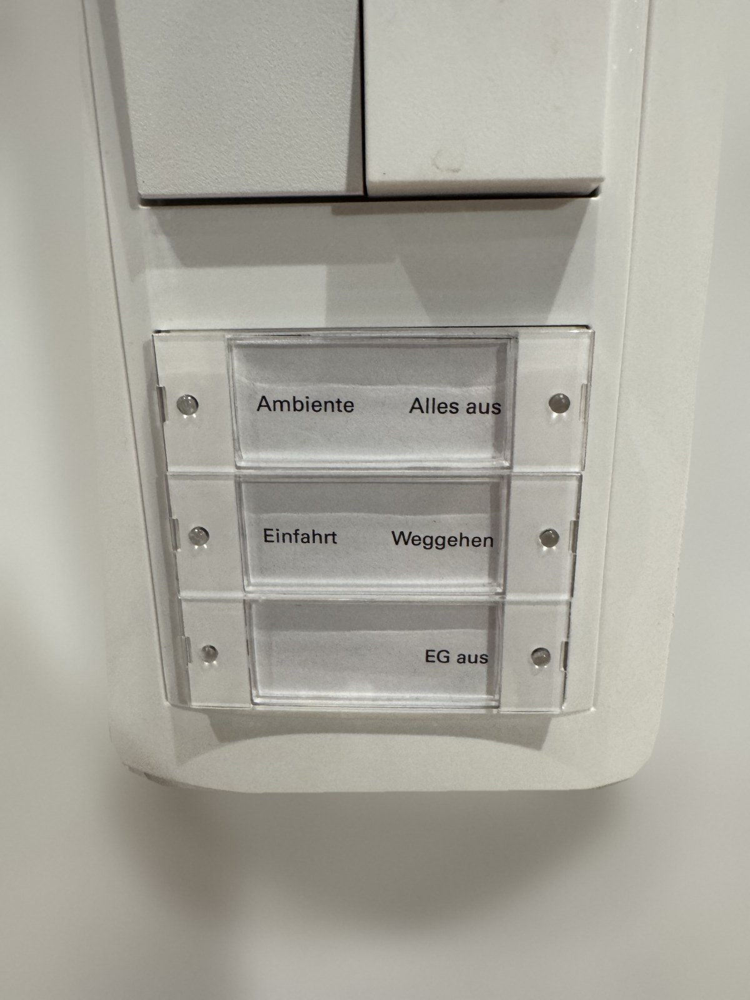
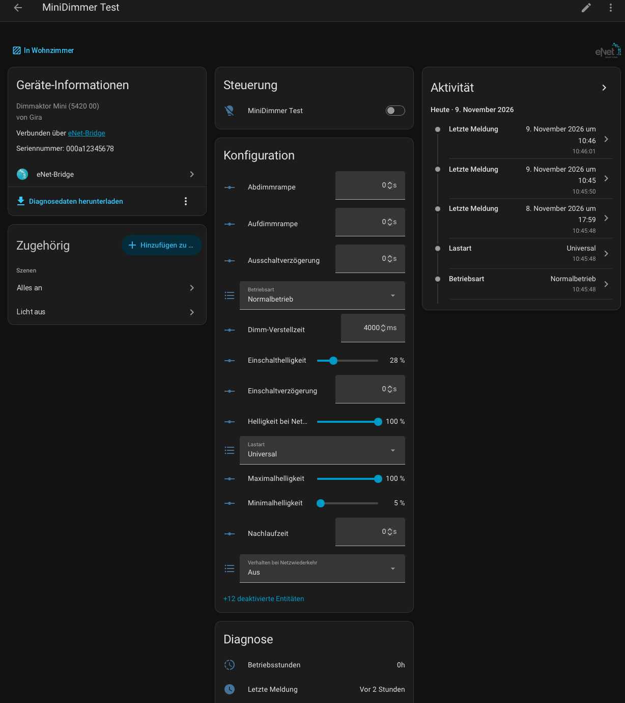
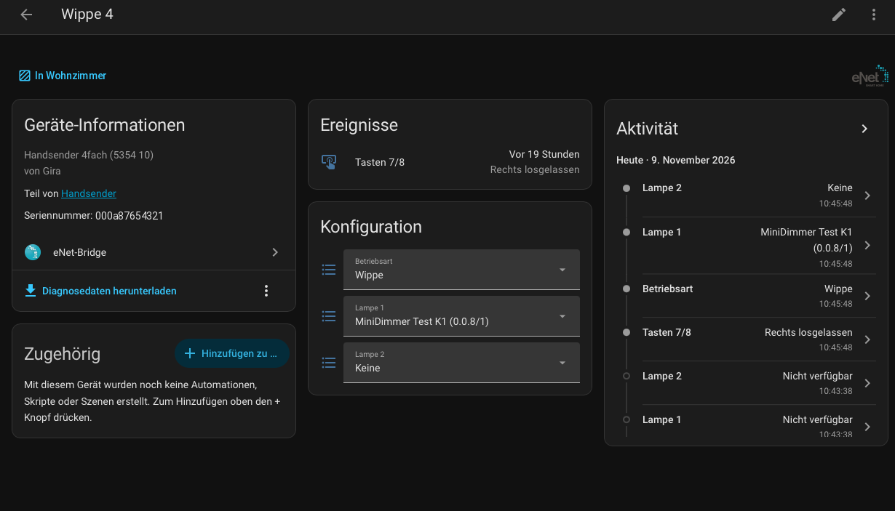
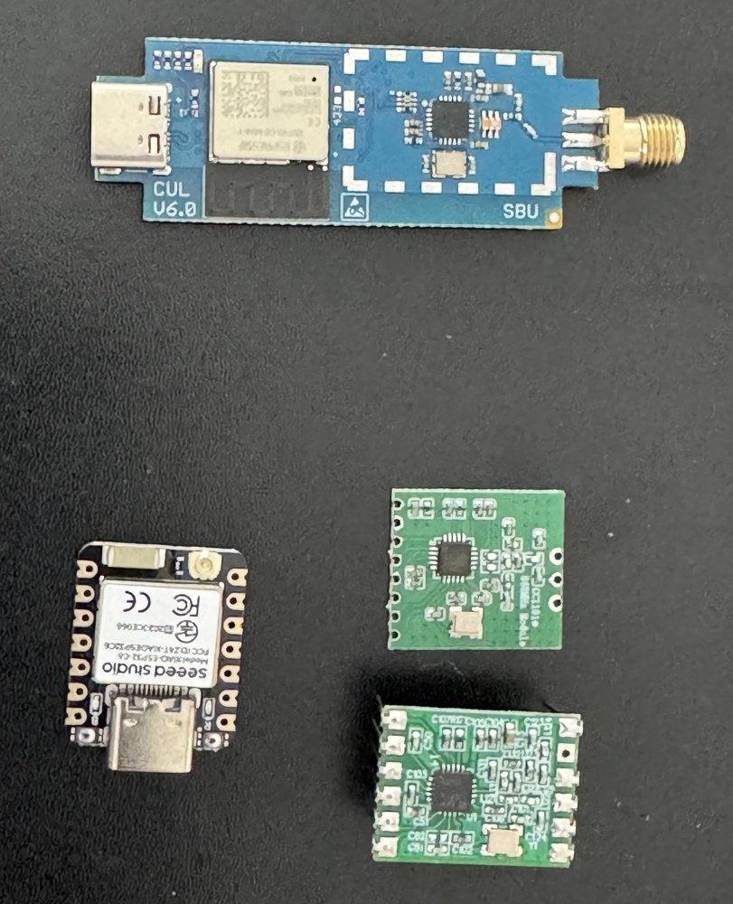

# eNet Bridge for Home Assistant

Use your **Gira / Jung eNet** radio devices directly in Home Assistant – **without the eNet Server**.

A small USB radio modem (ESP32-C6 + CC1101, about 20–30 € in parts) takes over the job of the eNet Server: it speaks
the eNet radio protocol (KNX RF 1.1, 868 MHz), answers the transmitters’ server buttons, runs scenes and reports
every button press and every state change to Home Assistant. The integration imports your existing installation
from the eNet Server’s export file – **no device has to be paired again**.

**Never had an eNet Server?** You can also start from scratch: set up a new installation, pair eNet actuators
and wall or hand-held transmitters with “+” in Home Assistant and configure everything there – no eNet Server
needed at any time.

*Deutsch: [README.de.md](README.de.md)*

> **Work in progress – first public release.** The integration runs two real installations every
> day, but documentation is still being completed, and only the device types listed below are tested. Feedback
> and issues are welcome.

> **Independent project.** Not affiliated with, endorsed or reviewed by Insta, Gira or Jung. Use at your own
> risk. See [Trademarks and origin](#trademarks-and-origin).

## Why replace the eNet Server?



I have an eNet Server myself. It works very well and is nicely integrated into Home Assistant with the
[eNet integration by mnordseth](https://github.com/mnordseth/enet-homeassistant). I still had three main reasons:

1. **The eNet Server is discontinued.** What happens when mine breaks? Keeping a spare server on the shelf was
   too expensive for me.
2. **The push-button sensors.** I like the Gira System 55 switches, and we have them everywhere. To call scenes
   or special functions, the eNet push-button sensor is ideal. But its connection to Home Assistant is
   incomplete: it works through the server, but the sensor gets no feedback.
3. **Two parallel systems.** With eNet and Home Assistant you maintain both: scenes have to be changed in eNet as
   soon as they involve eNet devices, and Home Assistant devices have to be attached with automations. I wanted
   to configure and program all devices from Home Assistant.

<br clear="right">

## Features

- **Take over an existing installation** from the eNet Server export (`.iex`): devices, rooms, scenes, button
  assignments. The bridge uses the server’s domain and identity, so actuators and transmitters keep working as
  before.
- **Listen-only mode** to run the bridge next to the real eNet Server first – it receives everything and sends
  nothing. Switch over when you are ready.
- **New installation without an eNet Server**: start from scratch and pair eNet actuators and transmitters directly
  from Home Assistant – for example to use Gira/Jung eNet wall transmitters and hand-held transmitters as
  battery-powered radio buttons in Home Assistant, without ever buying an eNet Server.
- **Lights**: switching and dimming actuators as `light` entities with real state feedback (status messages of
  the actuators, status requests after commands).
- **Transmitters** (hand-held and wall transmitters): every button as an event entity – pressed / released with
  hold time, so short, long and double presses can be told apart in automations. Battery state per transmitter.
- **Transmitter configuration from Home Assistant**: per rocker “rocker” (switches/dims lights directly) or
  “two single buttons” (server buttons with green LED acknowledgement); lights per rocker – eNet actuators or
  lights/switches of any other Home Assistant integration (Hue, Zigbee, Matter …), switched and dimmed by Home
  Assistant with green LED acknowledgement from the bridge; action per button (report only, call a scene);
  “Program transmitter” writes it to the device.
- **Scenes**: the Home Assistant scene is the original. Lights that are eNet actuators get the scene stored in
  the actuator as well, so a scene switches all of them at once with a single radio telegram. Scenes called from
  a transmitter are executed by the bridge itself – also when Home Assistant is busy.
- **Pairing and removing devices** without the eNet Server (“+” on the integration, delete button on the device).
- **Device settings** (switch-on brightness, ramps, delays, load type, …) as entities, read from and written to
  the actuators.
- **Sun sensor** (Jung FM FS 1 S / Gira 5461 02): illuminance, sun protection and twilight state, scene events,
  settings; a scene of your choice for sun protection and twilight on/off.
- **Repairs**: devices that do not answer, missing scene links, unknown transmitters and unexpected links in
  the actuators (leftovers of earlier assignments, links of foreign devices) show up under *Settings → Repairs*
  – removed only after confirmation.
- Bridge firmware is installed and updated by the integration itself; the radio is calibrated automatically.
- German and English user interface.

## Screenshots

**A dimming actuator** – light, all device settings read from the actuator, diagnostics:



**A rocker of a hand-held transmitter** – mode and lights chosen in Home Assistant, then “Program transmitter”:



*(German user interface; English is available as well.)*

## Supported devices

Tested in two installations:

| Type | Devices |
|---|---|
| Switching actuators | Mini 1-gang (SA1M, SA1MP), Mini 2-gang (SA2M), intermediate plug (SA1Z) |
| Dimming actuators | Mini dimmer (DA1M), DALI Mini (SD1M) |
| Transmitters | Wall transmitter 3-gang (WS3BG), hand-held transmitter 4-gang (HS4) |
| Blind/shutter actuators | Mini (5427 00): up/down/stop, position, slats, travel time measurement, rocker of a transmitter |
| Sensors | Sun/twilight sensor (SF1S, Jung FM FS 1 S) |

**Implemented from the manufacturer catalogue, not yet tested on a device** – shown in Home Assistant with
"(untested)" in the model name. If you have one of these, please report whether it works (an issue with the
"Download diagnostics" file helps most):

| Type | Devices | In Home Assistant |
|---|---|---|
| Other blind/shutter actuators (same channel type as the tested Mini 5427 00) | DIN-rail 1-gang (5437 00) and 4-gang (5435 00), System 2000 insert (5491) | cover: up/down/stop, position, slats |
| Energy sensors | Mini (5471 00), intermediate plug (5472 02), DIN-rail 4-gang (5473 00) | voltage, current, active/reactive/apparent power, energy (energy dashboard) |
| Motion detector | Jung FMDW360WW | motion, illuminance |
| Repeater | intermediate plug (5321 02) | signal, last message |
| DIN-rail switching/dimming modules | 5430 00, 5431 00, 5433 00 | like the Mini actuators |
| Operating top units | Memory (5492, 5493) on a System 3000 switching, 2-gang switching, dimming or blind insert | light or cover depending on the insert, rocker as event |

Device definitions (parameters) for all 41 eNet device types of the catalogue are included. Encrypted
installations (eNet Server 2.0 with AES) are not supported.

## Hardware



Two ways, both connected by USB to the Home Assistant host and running the same firmware:

- **Ready-made:** **busware CUL32** (ESP32-C6 + CC1101 with antenna socket, no soldering) – plug it in and the
  integration replaces busware’s firmware with the bridge firmware. Thanks to
  [Magnus Nordseth](https://github.com/mnordseth) for finding it.
- **Build it yourself:** Seeed **XIAO ESP32-C6** + CC1101 868 MHz module (7 wires) + 868 MHz antenna, parts
  ≈ 20–30 €.

Parts list, wiring, antenna and measurements: **[docs/HARDWARE.md](docs/HARDWARE.md)**.

<br clear="right">

## Installation

Requirements: Home Assistant **2026.10** or newer, a free USB port on the HA host.

**With HACS:** *HACS → ⋮ → Custom repositories*, add `https://github.com/engiadina/enet-bridge` as type
*Integration*, then install **eNet Bridge** and restart Home Assistant.

**Manually:** copy the folder `custom_components/enet_bridge` into `/config/custom_components/` of your Home
Assistant and restart it.

Then: *Settings → Devices & services → Add integration → eNet bridge.*

## Setup

The setup asks where the installation comes from:

- **Take over from an eNet Server export (.iex)** – export the project in the eNet Server web interface and
  upload the file. Leave **“The eNet Server is switched off”** unticked while the server is still running: the
  bridge then starts in **listen-only** mode.
- **New installation without eNet Server** – for installations that never had a server, or after it died
  without an export. A new domain and identity are generated; put each device into learning mode and pair it
  with “+” (one device at a time). Transmitters are programmed right after pairing.
- **Existing installation file** (`anlage.json`, from `tools/iex.py`).

Then choose the bridge’s serial port. If the board has no bridge firmware yet, install it with the update entity
**“Bridge firmware”**.

### Switching over from the eNet Server

1. Make a full Home Assistant backup.
2. Set up the integration from the export, server still running → listen-only.
3. Watch for a few days: do all button presses arrive as events, do the light states follow? (In listen-only mode
   lights that have not been switched yet show “unknown” – the bridge does not send status requests.)
4. Prepare your automations on the new button events, but leave them **off** – otherwise they trigger twice.
5. Switch off the old automations, **unplug the eNet Server**, then switch off **“Listen only”** on the bridge.
   The bridge now queries all actuators, converts the eNet scenes into Home Assistant scenes (*Settings →
   Automations & scenes → Scenes*) and answers the server buttons.
6. Remove the old eNet integration (if you used one) and, if you like, rename the new light entities to the old
   entity IDs so that dashboards and automations keep working.
7. Switch on the new automations and test every button and scene.

Until step 6 you can go back at any time: switch the server on again and “Listen only” on.

## Using it

**Buttons.** A rocker that switches lights directly reports the event types `links_gedrueckt` /
`links_losgelassen` / `rechts_gedrueckt` / `rechts_losgelassen` (shown as “Left pressed”, “Left released”, …), a
single button `gedrueckt` / `losgelassen` (pressed / released). The release event carries `hold_ms`, e.g. a long
press:

```yaml
triggers:
  - trigger: state
    entity_id: event.hallway_rocker_1_button_2
    not_from: [unavailable, unknown]
conditions:
  - condition: template
    value_template: >-
      {{ trigger.to_state.attributes.event_type == 'losgelassen'
         and trigger.to_state.attributes.hold_ms | int(0) >= 1000 }}
```

Only buttons that ask for an answer get the green LED: single buttons (the bridge answers) and rockers linked to
actuators (the actuator answers). A rocker without lights sends its value without asking – no LED. For HA-only
buttons with LED, set the rocker to **two single buttons** with action **“Report only”** and press
**“Program transmitter”** (then press a button on the transmitter to wake it up). The integration installs the
blueprint **“eNet Bridge – transmitter single keys”** (short/long press per key) under
`blueprints/automation/enet_bridge/`.

**Rocker with Home Assistant lights.** A rocker can also switch and dim lights of other integrations: choose them
as “Lamp 1/2” on the transmitter's device page (or under *Configure → Configure sender*). Left button = on /
brighter, right button = off / darker; hold to dim. Adding the first or removing the last HA light reprograms the
transmitter; changing which HA lights are used takes effect immediately. The bridge acknowledges the rocker (green
LED) only while no eNet Server is running; Home Assistant switches the lights either way.

**Scenes.** Create and edit them as normal Home Assistant scenes. eNet lights in a scene get the scene values
stored in the actuators (they restart briefly while being programmed – lights flicker once). Assign a scene to a
single button via its action select.

**Pairing.** “+” on the integration → *Add device* → put the device into learn mode (Mini actuators: press the
button on the device for 4 s). **Removing:** delete the device in Home Assistant; it is reset to factory state.

**Services:** `enet_bridge.geraet_einlernen` (pair), `geraet_entfernen` (remove), `sender_programmieren`
(program transmitter), `verknuepfungen_lesen` (read and rate the actuators’ link tables), `szene_anlegen` / `szene_loeschen` (eNet scenes), `release` / `reconnect` (free / reopen
the serial port).

## Troubleshooting

- **“Radio module” off:** wiring or 3.3 V supply of the CC1101.
- **A device never reports / “does not answer” under Repairs:** look at its “Signal” sensor; below ≈ −90 dBm move
  the bridge or antenna, check the antenna connection ([HARDWARE.md](docs/HARDWARE.md#antenna-connection)).
- **“Real eNet server active”:** the bridge hears the original server – both answer the server buttons. Switch
  the server off.
- **Buttons trigger twice after switching over:** old and new automations are both on.
- **A lamp reacts to buttons it should not** (e.g. dims on release): call `enet_bridge.verknuepfungen_lesen`
  for it and look under Repairs for unexpected links.
- Logs: *Settings → System → Logs*, filter `enet_bridge`.

### Reporting a problem

Please open an [issue](https://github.com/engiadina/enet-bridge/issues/new/choose) and attach two files:

1. **Diagnostics:** *Settings → Devices & services → eNet Bridge → ⋮ → Download diagnostics*. Contains versions,
   your installation (devices, rocker assignments, scenes), link check results, states and the last 300
   messages between Home Assistant and the bridge. The domain, all serial numbers, names, rooms and entity IDs
   are replaced by placeholders (SN1, Name1 …) – they would allow others to address your devices by radio.
2. **Debug log:** *⋮ → Enable debug logging*, reproduce the problem, then *⋮ → Disable debug logging* – Home
   Assistant downloads the log file.

**Unknown device type** (pairing says “unknown type”): attach the diagnostics as well – they list the product
number the device reported, so support can be added.

## Development

Firmware: PlatformIO (`pio run -e esp32dev`, XIAO ESP32-C6: `-e xiao_esp32c6`; `tools/fw_bundle.sh` bundles both in `bridge_fw/`). Protocol logic
has host tests: `pio test -e native`. Bridge ↔ host interface (serial JSON lines):
[docs/INTERFACE.md](docs/INTERFACE.md).

## License

Copyright 2026 Guido Weckwerth. Licensed under the [Apache License 2.0](LICENSE), **except** the icon/logo in
`custom_components/enet_bridge/brand/` (eNet trademark, not licensed) and the manufacturer data in
`definitionen.json` (no rights claimed or granted) – details in [NOTICE](NOTICE) and below.

## Trademarks and origin

eNet, eNet SMART HOME, Gira and Jung are trademarks or registered trademarks of their respective owners (Insta
GmbH, Gira Giersiepen GmbH & Co. KG, Albrecht Jung GmbH & Co. KG). This project is independent and not
affiliated with these companies; it is neither supported nor reviewed by them.

The integration’s icon and logo (`custom_components/enet_bridge/brand/`) are the eNet logo as also used by the
Home Assistant brands repository (home-assistant/brands). As there, they only indicate which devices the
integration works with; they do not imply endorsement by the trademark owners, who hold all rights to them.

The device definitions (`custom_components/enet_bridge/definitionen.json`) contain only technical data needed to
operate the devices (channels, group object offsets, parameter addresses, encodings, value ranges, selection
values, product numbers) – no descriptive texts or images. They were converted into an own structure from the
device catalogue contained in the eNet Server’s update file, and checked and extended by own measurements and
recordings for the tested devices. Their purpose is interoperability with existing eNet devices.
