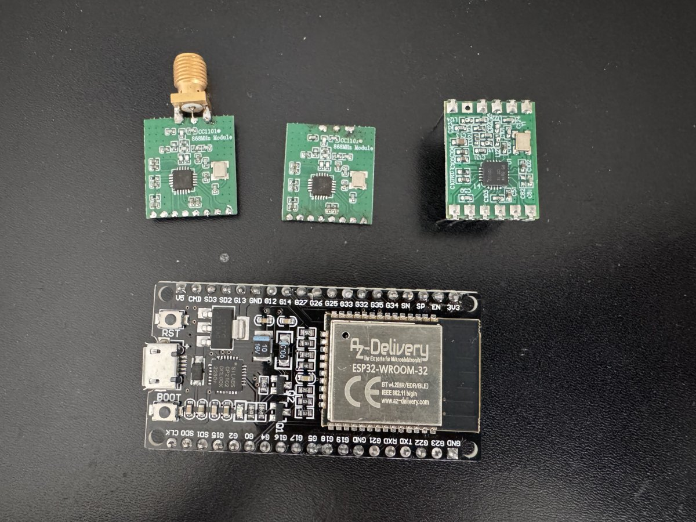

# eNet Bridge – hardware

The bridge is a small radio modem: an **ESP32** development board and a **TI CC1101** sub-GHz transceiver on
868 MHz, connected to the Home Assistant host by **USB**. There is no Wi-Fi connection – deliberately (see
[Why USB](#why-usb-and-not-wi-fi)). Cost: roughly 25–35 € in parts.

## Components



These are the components you need to build the bridge:

- **Bottom:** ESP32 board – AZ-Delivery ESP32 Dev Kit C (ESP32-WROOM-32, CP2102 USB-UART, 38 pins, micro-USB).
- **Top left and middle:** the cheap green “CC1101 868MHz Module” from Amazon – once with an SMA socket soldered
  on, once without.
- **Top right:** the somewhat more expensive Italian module **Radiocontrolli RC-CC1101-SPI-868**, available from
  TME.

The modules are wired on a prototyping board or soldered to the ESP32 with short wires. If you don’t want to
solder, take the TME module: it already has pins and can be connected with jumper wires. In principle the Amazon
modules work too – only their antenna is completely useless (see [below](#cheap-cc1101-868-mhz-modules)).

For a start, a **straight wire of 8.6 cm** is enough as antenna: soldered directly to the RF output, or plugged
onto the antenna pin of the TME module. A proper antenna with a connection cable is nicer, but then you have to
solder – see [Housing](#housing).

## Parts list

| Part | Recommendation | Notes |
|---|---|---|
| Microcontroller | ESP32 DevKit with ESP32-WROOM-32 (classic ESP32, “esp32dev”), e.g. AZ-Delivery ESP32 Dev Kit C | Any board with a USB-UART chip (CP2102/CP210x, CH340) works. Not ESP32-S2/S3/C3/C6 – the firmware is built for the classic ESP32. |
| Radio module | **Radiocontrolli RC-CC1101-SPI-868** (through-hole) | Genuine TI CC1101, matched for 868 MHz, accurate crystal (measured −7 ppm). Available from TME. |
| Antenna connector | SMA female, panel or PCB mount | Soldered directly to the module’s antenna pin. |
| Antenna | 868 MHz rubber antenna with SMA, ≈ 2–3 dBi | Alternative: straight wire of 8.6 cm (λ/4) on the antenna pin. |
| Capacitor | 100 nF ceramic | Directly between VCC and GND at the module. |
| Wiring | short wires (< 10 cm) or a small perfboard | Keep SPI lines short. |
| USB cable | data cable to the HA host | Power comes from USB (≈ 18 mA receive, 30 mA transmit for the radio). |

### Cheap “CC1101 868 MHz” modules

The common green 8-pin modules sold as “CC1101 868 MHz” also work and were used for the first prototypes, but:

- their crystal was off by ≈ 100 ppm (≈ 95 kHz at 868 MHz) – the bridge corrects this automatically;
- the chip reported a different version (0x04 instead of 0x14), possibly a clone;
- the noise floor was about 7 dB higher than with the RC-CC1101-SPI-868 (see below);
- the coil antenna usually supplied is for 433 MHz – replace it.

With the RC-CC1101-SPI-868 the noise floor was 7 dB lower and the weakest decodable telegram ≈ −98 dBm. Use it if
you can.

## Wiring

The GPIOs are the same for every module (`src/config.h`); only the pin order on the module differs.

| Signal | ESP32 DevKit | RC-CC1101-SPI-868 pin | green 8-pin module pin |
|---|---|---|---|
| VCC (**3.3 V, never 5 V**) | 3V3 | 12 | 1 |
| GND | GND | 7, 8, 9 (connect all three) | 2 |
| MOSI / SI | GPIO 23 | 1 | 3 |
| SCK / SCLK | GPIO 18 | 2 | 4 |
| MISO / SO | GPIO 19 | 3 | 5 |
| GDO2 (carrier sense, diagnostics) | GPIO 16 | 4 | 6 |
| GDO0 (sync / end of packet) | GPIO 4 | 5 | 7 |
| CSn | GPIO 5 | 6 | 8 |
| Antenna | – | 10 (ANT, 50 Ω) | antenna pad |

The green module has no pin labels – use the drawing below. Other modules may be wired differently.

### Green “CC1101 868MHz Module” pinout

About 15 × 17 mm. 8 pads in one row on the edge opposite the antenna, pitch about 2 mm (estimated from the photo –
**not 2.54 mm**, so it does not fit a breadboard or perfboard directly; solder short wires). Three antenna pads on
the opposite edge.

```
   component side up, antenna pads on top:

                GND   ANT   GND
          ┌──────●─────●─────●──────┐
          │ CC1101 868MHz Module    │
          │                         │
          │   [CC1101]      ▭       │   (▭ = crystal)
          │                         │
          └─●──●──●──●──●──●──●──●──┘
            8  7  6  5  4  3  2  1
            CSn   GDO2  SCK   GND
               GDO0  MISO  MOSI  VCC
```

Pin 1 (VCC) is on the **right** when the component side faces up and the antenna pads point away from you. Seen
from the bottom side the order is mirrored. Check before soldering: pin 2 must be connected to the outer antenna
pads (GND).

Antenna: the 8.6 cm wire goes on the middle pad (ANT). With an SMA socket, solder the centre pin to the middle
pad and the socket ground to the two outer pads, as short as possible.

### RC-CC1101-SPI-868 pinout

Module 21.5 × 15.6 mm, 2.54 mm pitch, 11 pins in two rows (pin 11 is missing). Datasheet: radiocontrolli.com,
`RC-CC1101-SPI-868.pdf`, rev. 1.6, page 2.

```
            ┌───────────────────────┐
   SI    1 ─┤                       ├─ 12  VCC
   SCLK  2 ─┤                       │      (11 missing)
   SO    3 ─┤                       ├─ 10  ANT
   GDO2  4 ─┤        CC1101         ├─  9  GND
   GDO0  5 ─┤                       ├─  8  GND
   CSn   6 ─┤                       ├─  7  GND
            └───────────────────────┘
```

Pin 1 is top left when the crystal points down. The drawing does not say whether it shows the top or the bottom
side, so **check before soldering: pins 7, 8 and 9 must be connected to each other (GND).**

## Antenna connection

- SMA centre pin directly to module pin 10 (ANT), SMA ground directly to pin 9 (next to it). No flying leads in
  between – this short path is the 50 Ω line.
- **Do not swap centre and ground.** A first build had the SMA ground on ANT: SPI and registers looked fine and the
  module even transmitted on 868.3 MHz, but no telegram was decoded in either direction.
- No traces and no ground plane under the module; ground around the antenna connection is fine.
- A rubber antenna was ≈ 10 dB better than a wire on the same connector, and the coil antenna supplied with cheap
  modules ≈ 10 dB worse than a straight 8.6 cm wire.

## Housing


With a real antenna and a connection cable the bridge can look like this: a 3D-printed housing with the antenna on
top and the USB socket at the bottom. Inside it looks wild – the primary fastening material is hot glue.
The STL files are in [`hardware/gehaeuse/`](../hardware/gehaeuse/).

A better construction may follow, especially once the bridge software runs on the ESP32-C6. Then no USB
connection to the Home Assistant server is needed any more; the connection is planned via Thread (see
[Why USB](#why-usb-and-not-wi-fi)). That is still a thing of the future.

<br clear="right">

## Placement

- Put the bridge (or at least the antenna) **centrally** and high, not in a metal cabinet or directly next to the
  HA host, routers or USB 3 devices. A USB extension cable helps.
- One bridge covers a normal house (tested: two floors). Actuators can additionally act as repeaters (device
  setting “Repeater”).
- The integration shows the received level of every device (sensor “Signal”, dBm). Values above ≈ −80 dBm are
  comfortable; with the RC module telegrams down to ≈ −95 dBm are still decoded.

## Putting it into operation

1. Connect the ESP32 by USB to the Home Assistant host. A blank ESP32 is fine.
2. Install and set up the integration ([README](../README.md#installation)). Choose the serial port of the
   bridge. Radios of other integrations (Thread/Zigbee/Z-Wave sticks) are never offered.
3. Without bridge firmware, the update entity **“Bridge firmware”** offers the installation – the integration
   flashes the ESP32 itself over USB (esptool is included). Later firmware updates are installed automatically.
4. The integration transfers the configuration and checks the radio: the entity **“Radio module”** must be on.
   If it is off: check wiring and 3.3 V.
5. **Frequency correction** is found and tracked automatically (search via status requests when no actuator
   answers, then continuous fine adjustment from received telegrams, also in listen-only mode). Nothing to set by
   hand. The diagnostic entity “Frequency correction” (disabled by default) shows the value: RC module ≈ −4,
   green modules ≈ +60.

## Checks and measurements

Reference measurements (office test installation, same place, bridge firmware 0.8.5+):

| | green module | RC-CC1101-SPI-868 |
|---|---|---|
| Chip version (register 0xF1) | 0x04 | 0x14 |
| Frequency correction | +60 (≈ +95 kHz, ≈ 110 ppm) | −4 (≈ −6.3 kHz, ≈ −7 ppm) |
| Noise floor without antenna | −112 dBm | −119 dBm |
| Actuators answering without antenna (of 4) | 1 | 2 |
| All actuators with antenna | 4/4, first attempt | 4/4, first attempt |

Diagnostics over the serial console (115200 baud): `d` shows the
GDO lines, chip state, RSSI and channel occupancy, `s` the receive statistics, `r` the CC1101 registers.

## Why USB and not Wi-Fi

- Wi-Fi networks have a limited number of clients and are shared with many other devices.
- In segmented networks the connection between bridge and Home Assistant can become arbitrarily complicated.
- If Home Assistant is reachable from outside, every Wi-Fi device is one more attack surface.

The firmware therefore has no network connection at all. A wireless option for the future would be Thread
(e.g. ESP32-C6), with authentication on application level and signed firmware updates – not implemented.

## Radio parameters (for reference)

eNet is KNX RF 1.1: 868.3 MHz, 2-FSK, Manchester coded, 32.768 kchip/s (same physical layer as wM-Bus mode S),
sync word 0x7696, CRC 0x3D65 per block. Transmit power ≈ +10 dBm (PATABLE 0xC0). The CC1101 register set is in
`src/cc1101.cpp`; listen-before-talk with carrier sense (threshold +6 dB) avoids collisions with other 868 MHz
traffic.
