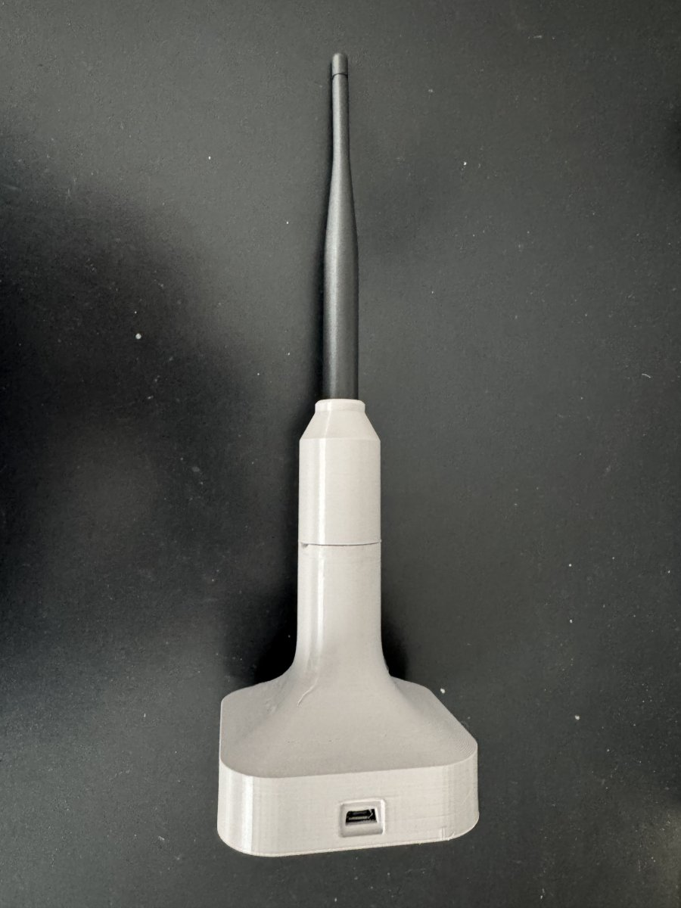

# eNet Bridge – hardware

The bridge is a small radio modem: an **ESP32-C6** microcontroller and a **TI CC1101** sub-GHz transceiver on
868 MHz, connected to the Home Assistant host by **USB**. There is no Wi-Fi connection – deliberately (see
[Why USB](#why-usb-and-not-wi-fi)).


There are two ways to get one, both with the same firmware:

- **Ready-made: [busware CUL32](https://busware.de/products/cul32/)** (top in the photo) – ESP32-C6 and CC1101 on
  one board with an RP-SMA antenna socket and USB-C, optional housing. No soldering: plug it in and the integration
  installs the bridge firmware. Thanks to [Magnus Nordseth](https://github.com/mnordseth) for finding this stick.
- **Build it yourself: [Seeed XIAO ESP32-C6](https://wiki.seeedstudio.com/xiao_esp32c6_getting_started/)**
  (bottom left) **+ CC1101 868 MHz module** (bottom right: the cheap 8-pin module and, below it, the Radiocontrolli
  RC-CC1101-SPI-868), 7 wires, parts ≈ 20–30 €.

Both are tested in a real installation: receiving, switching/dimming, blinds, server buttons and scenes,
programming transmitters, firmware updates from Home Assistant.

<br clear="right">

## Building it yourself

### Parts list

| Part | Recommendation | Notes |
|---|---|---|
| Microcontroller | **Seeed XIAO ESP32-C6** | USB-C (native USB of the chip), 3.3 V output for the radio, yellow LED flashes on radio traffic. Other ESP32-C6 boards work if the same GPIOs are free (see wiring). Not ESP32-S2/S3/C3. |
| Radio module | **Radiocontrolli RC-CC1101-SPI-868** (through-hole) | Genuine TI CC1101, matched for 868 MHz, accurate crystal (measured −7 ppm), 2.54 mm pins. Available from TME. |
| Antenna connector | SMA female, panel or PCB mount | Soldered directly to the module’s antenna pin. |
| Antenna | 868 MHz rubber antenna with SMA, ≈ 2–3 dBi | Alternative: straight wire of 8.6 cm (λ/4) on the antenna pin. |
| Capacitor | 100 nF ceramic | Directly between VCC and GND at the module. |
| Wiring | short wires (< 10 cm) or a small perfboard | Keep SPI lines short. |
| USB cable | data cable to the HA host | Power comes from USB (≈ 18 mA receive, 30 mA transmit for the radio). |

If you don’t want to solder much, take the RC module: it has pins and can be connected with jumper wires. For a
start, a **straight wire of 8.6 cm** is enough as antenna. A proper antenna with an SMA socket is better (≈ 10 dB),
see [Antenna connection](#antenna-connection).

### Cheap “CC1101 868 MHz” modules

The cheap 8-pin modules sold as “CC1101 868 MHz” also work, but:

- their crystal was off by ≈ 100 ppm (≈ 95 kHz at 868 MHz) – the bridge corrects this automatically;
- the chip reported a different version (0x04 instead of 0x14), possibly a clone;
- the noise floor was about 7 dB higher than with the RC-CC1101-SPI-868 (see [measurements](#checks-and-measurements));
- the pads have a pitch of about 2 mm, not 2.54 mm – solder short wires;
- the coil antenna usually supplied is for 433 MHz – replace it.

With the RC-CC1101-SPI-868 the weakest decodable telegram was ≈ −98 dBm. Use it if you can.

### Wiring

The GPIOs are fixed in the firmware (`src/config.h`) and are the same as on the CUL32; only the pin order on the
radio module differs.

| Signal | XIAO ESP32-C6 | RC-CC1101-SPI-868 pin | cheap 8-pin module pin |
|---|---|---|---|
| VCC (**3.3 V, never 5 V**) | 3V3 | 12 | 1 |
| GND | GND | 7, 8, 9 (connect all three) | 2 |
| MOSI / SI | D3 (GPIO 21) | 1 | 3 |
| SCK / SCLK | D8 (GPIO 19) | 2 | 4 |
| MISO / SO | D9 (GPIO 20) | 3 | 5 |
| GDO0 (sync / end of packet) | D2 (GPIO 2) | 5 | 7 |
| CSn | D10 (GPIO 18) | 6 | 8 |
| GDO2 | not needed | 4 (leave open) | 6 (leave open) |
| Antenna | – | 10 (ANT, 50 Ω) | antenna pad |

XIAO pins D0, D1 and D4–D7 stay free. Its only USB-C socket is the chip’s native USB, which shows up as
`/dev/serial/by-id/usb-Espressif_USB_JTAG_serial_debug_unit_…`. The XIAO’s own antenna (or u.FL socket) is for
2.4 GHz only and is not used – eNet runs through the CC1101 and its 868 MHz antenna.

#### RC-CC1101-SPI-868 pinout

Module 21.5 × 15.6 mm, 2.54 mm pitch, 11 pins in two rows (pin 11 is missing). Datasheet: radiocontrolli.com,
`RC-CC1101-SPI-868.pdf`, rev. 1.6, page 2.

```
            ┌───────────────────────┐
   SI    1 ─┤                       ├─ 12  VCC
   SCLK  2 ─┤                       │      (11 missing)
   SO    3 ─┤                       ├─ 10  ANT
   GDO2  4 ─┤        CC1101         ├─  9  GND
   GDO0  5 ─┤                       ├─  8  GND
   CSn   6 ─┤                       ├─  7  GND
            └───────────────────────┘
```

Pin 1 is top left when the crystal points down. The drawing does not say whether it shows the top or the bottom
side, so **check before soldering: pins 7, 8 and 9 must be connected to each other (GND).**

#### Cheap 8-pin “CC1101 868MHz Module” pinout

About 15 × 17 mm, no pin labels. 8 pads in one row on the edge opposite the antenna, three antenna pads on the
other edge.

```
   component side up, antenna pads on top:

                GND   ANT   GND
          ┌──────●─────●─────●──────┐
          │ CC1101 868MHz Module    │
          │                         │
          │   [CC1101]      ▭       │   (▭ = crystal)
          │                         │
          └─●──●──●──●──●──●──●──●──┘
            1  2  3  4  5  6  7  8
            VCC   MOSI  MISO  GDO0
               GND   SCK   GDO2  CSn
```

Pin 1 (VCC) is on the **left** when the component side faces up and the antenna pads point away from you. Seen
from the bottom side the order is mirrored. Check before soldering: pin 2 must be connected to the outer antenna
pads (GND). The 8.6 cm wire goes on the middle pad (ANT); with an SMA socket, solder the centre pin to the middle
pad and the socket ground to the two outer pads, as short as possible.

### Antenna connection

- SMA centre pin directly to the ANT pin, SMA ground directly to the GND pin next to it. No flying leads in
  between – this short path is the 50 Ω line.
- **Do not swap centre and ground.** A first build had the SMA ground on ANT: SPI and registers looked fine and the
  module even transmitted on 868.3 MHz, but no telegram was decoded in either direction.
- No traces and no ground plane under the module; ground around the antenna connection is fine.
- A rubber antenna was ≈ 10 dB better than a wire on the same connector, and the coil antenna supplied with cheap
  modules ≈ 10 dB worse than a straight 8.6 cm wire.

### Housing



With a real antenna the bridge can look like this: a 3D-printed housing with the antenna on top and the USB socket
at the bottom. The STL files are in [`hardware/gehaeuse/`](../hardware/gehaeuse/). The housing was designed for a
larger board – with the XIAO a much more compact one is possible. The CUL32 is available with a housing.

<br clear="right">

## busware CUL32

The firmware uses exactly the CUL32’s CC1101 pin assignment, so no wiring is needed. Screw on an 868 MHz antenna,
plug the stick in by USB-C and set up the integration – it recognises that busware’s own firmware (culfw32) does not
answer the bridge protocol and replaces it with the bridge firmware (about 15 s). Its blue LED flashes on radio
traffic, like the yellow LED of the XIAO.

## Placement

- Put the bridge (or at least the antenna) **centrally** and high, not in a metal cabinet or directly next to the
  HA host, routers or USB 3 devices. A USB extension cable helps.
- One bridge covers a normal house (tested: two floors). Actuators can additionally act as repeaters (device
  setting “Repeater”).
- The integration shows the received level of every device (sensor “Signal”, dBm). Values above ≈ −80 dBm are
  comfortable; with the RC module telegrams down to ≈ −95 dBm are still decoded.

## Putting it into operation

1. Connect the CUL32 or the XIAO with its radio module by USB to the Home Assistant host. A blank board is fine.
2. Install and set up the integration ([README](../README.md#installation)). Choose the serial port of the
   bridge. Radios of other integrations (Thread/Zigbee/Z-Wave sticks) are never offered.
3. Without bridge firmware, the integration flashes the board itself over USB (update entity **“Bridge firmware”**;
   esptool is included). Later firmware updates are installed automatically.
4. The integration transfers the configuration and checks the radio: the entity **“Radio module”** must be on.
   If it is off: check wiring and 3.3 V.
5. **Frequency correction** is found and tracked automatically (search via status requests when no actuator
   answers, then continuous fine adjustment from received telegrams, also in listen-only mode). Nothing to set by
   hand. The diagnostic entity “Frequency correction” (disabled by default) shows the value: RC module and CUL32 a
   few kHz, cheap 8-pin modules ≈ +95 kHz.

## Checks and measurements

Reference measurements of the radio modules (office test installation, same place):

| | cheap 8-pin module | RC-CC1101-SPI-868 | CUL32 |
|---|---|---|---|
| Chip version (register 0xF1) | 0x04 | 0x14 | 0x14 |
| Frequency correction | ≈ +95 kHz (≈ 110 ppm) | ≈ −6 kHz (≈ −7 ppm) | ≈ +1.6 kHz |
| Noise floor without antenna | −112 dBm | −119 dBm | not measured |
| All actuators with antenna | 4/4, first attempt | 4/4, first attempt | all, first attempt |

**The noise floor with an antenna is not a module property.** With an antenna the bridge also picks up everything
on 868 MHz around it (radio traffic, power supplies, USB, computers), so the value depends mainly on the place and
the time: in the same office the CUL32 showed −101 dBm and a XIAO with RC module −90 dBm on another day, a bridge
at home −106 dBm. A fair comparison needs both bridges at the same place at the same time with the same antenna.

Diagnostics over the serial console (115200 baud): `d` shows the GDO lines, chip state, RSSI and channel
occupancy, `s` the receive statistics, `r` the CC1101 registers, `spi` checks the CSn and MISO lines without SPI
(“CC1101 not found”: if MISO stays high with CSn low, the chip is selected but its crystal does not start – replace
the module).

## Why USB and not Wi-Fi

- Wi-Fi networks have a limited number of clients and are shared with many other devices.
- In segmented networks the connection between bridge and Home Assistant can become arbitrarily complicated.
- If Home Assistant is reachable from outside, every Wi-Fi device is one more attack surface.

The firmware therefore has no network connection at all. A wireless option for the future would be Thread – the
ESP32-C6 supports it – with authentication on application level and signed firmware updates; not implemented.

## Radio parameters (for reference)

eNet is KNX RF 1.1: 868.3 MHz, 2-FSK, Manchester coded, 32.768 kchip/s (same physical layer as wM-Bus mode S),
sync word 0x7696, CRC 0x3D65 per block. Transmit power ≈ +10 dBm (PATABLE 0xC0). The CC1101 register set is in
`src/cc1101.cpp`; listen-before-talk with carrier sense avoids collisions with other 868 MHz traffic.
